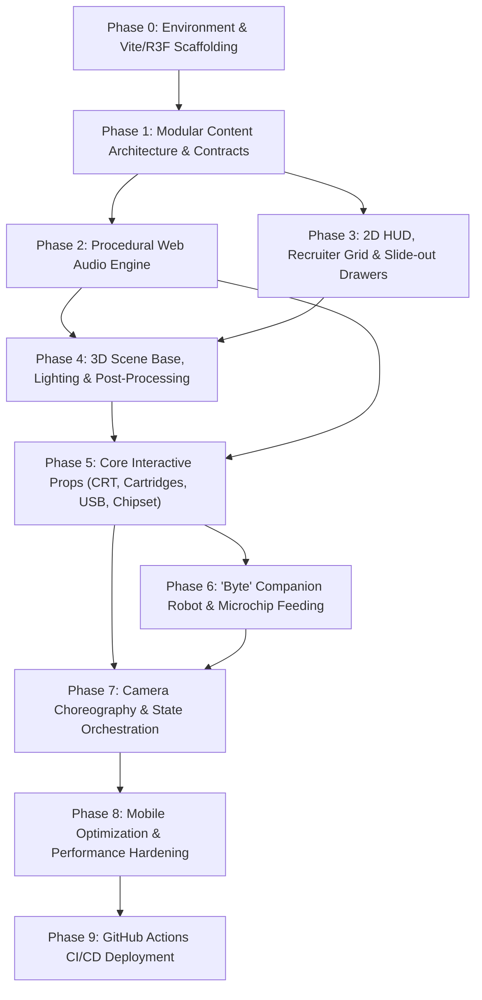

# Cyberpunk Unity Portfolio: Step-by-Step Execution Plan

**Project:** Interactive 3D Cyberpunk Portfolio  
**Target:** GitHub Pages (`c:\Alirezaftgithubpages`)  
**Architecture:** React + Vite + TypeScript + React Three Fiber + Tailwind CSS + Web Audio API  

---

## 1. Development Sequence & Phase Order

Building an interactive 3D web experience requires a strict **"Outside-In, Data-First"** assembly sequence. Creating 3D models before having data contracts or UI overlays leads to major rework. 

Here is the 9-phase dependency chain:



---

## 2. Phase-by-Phase Execution Breakdown

### Phase 0: Environment Setup & Scaffolding
* **Objective:** Establish the build foundation, verify GitHub Pages paths, and setup dependencies.
* **Tasks:**
  1. Initialize Vite React TypeScript project in `c:\Alirezaftgithubpages`.
  2. Install core packages:
     * `three`, `@types/three`
     * `@react-three/fiber`, `@react-three/drei`, `@react-three/postprocessing`
     * `tailwindcss`, `postcss`, `autoprefixer`
     * `lucide-react`, `clsx`, `tailwind-merge`, `canvas-confetti`
  3. Configure `vite.config.ts` with `base: './'` for proper static asset routing on GitHub Pages.
  4. Test empty R3F `<Canvas>` with DPR clamping (`[1, 1.5]`) and resize listener.

---

### Phase 1: Modular Content Architecture & Data Contracts
* **Objective:** Establish the modular file structure so content is decoupled from 3D presentation.
* **Tasks:**
  1. Create directory structure:
     * `src/content/projects/`
     * `src/content/skills/`
     * `src/content/profile/`
     * `src/content/companion/`
  2. Define TypeScript interfaces:
     * `Project`: ID, title, tagline, engine, tags, videoUrl, screenshots, techDeepDive (architecture, shaders, optimization), links (Steam, Itch, GitHub, webglDemoUrl).
     * `SkillChip`: ID, socketType (`cpu` | `gpu` | `ram` | `expansion`), label, category, proficiency, authenticMetrics, crossLinkedProjectIds.
     * `ProfileConfig`: Name, title, bio, careerTimeline, socials, resumePath.
     * `RobotLore`: Quotes, devTips, reactionLines, trivia.
  3. Populate 3 high-polish curated Unity projects (e.g., *Cyberpunk Action Platformer*, *Procedural Roguelike Dungeon*, *Compute Shader Fluid Simulation*).

---

### Phase 2: Procedural Web Audio Engine (Tactile SFX)
* **Objective:** Build the audio engine early so all subsequent interactions have instant tactile feedback.
* **Why Early?** Synthesizing audio via the native **Web Audio API** requires **0KB** of audio downloads and gives immediate kinetic impact.
* **Tasks:**
  1. Implement `src/audio/soundManager.ts`:
     * `playClick()`: Crisp high-frequency cyber tick (triangle/sine envelope, 15ms).
     * `playCrtPower()`: Low hum rising into high pitch phosphor buzz (sawtooth + bandpass filter).
     * `playBusPulse()`: Electrical data blip.
     * `playUsbPlug()`: Heavy mechanical snap + power-surge frequency sweep.
     * `playRobotChirp()`: Double harmonic sine frequency blips (cute Wall-E / R2 style).
     * `playRobotPurr()`: Low frequency vibrato purr when petted.
  2. Implement global audio state hook `useAudio` with opt-in mute toggle, volume control, and `localStorage` persistence.

---

### Phase 3: 2D HUD, Recruiter Grid & Slide-out Drawers
* **Objective:** Build the complete 2D UI layer so the portfolio is 100% functional even before 3D props are fully assembled.
* **Tasks:**
  1. **Top HUD (`src/components/ui/Hud.tsx`):**
     * Title logo / Status beacon (`ONLINE // DEV_STATION`).
     * Sound Toggle button with animated equalizer bars.
     * Mode Switcher: `[3D CYBER-DECK]` ⟷ `[RECRUITER GRID VIEW]`.
  2. **Recruiter Grid View (`src/components/ui/RecruiterGrid.tsx`):**
     * Fast, searchable, filterable grid of all projects, technical skill chips, bio timeline, and direct 1-click resume download.
  3. **Project Drawer (`src/components/ui/ProjectDrawer.tsx`):**
     * Slide-out glassmorphic panel on the right.
     * Video player, screenshot gallery, C# architecture breakdown, shader notes, and links.
  4. **Skill Telemetry Modal (`src/components/ui/SkillModal.tsx`):**
     * Floating AR schematic showing real engineering metrics and project cross-links.

---

### Phase 4: 3D Scene Base, Lighting & Post-Processing
* **Objective:** Create the visual cyberpunk atmosphere and 3D foundation.
* **Tasks:**
  1. **Lighting Rig:**
     * Dark ambient base (`#050811`).
     * Cyan key light (`#00f3ff`) illuminating the left work area.
     * Magenta rim light (`#ff007f`) highlighting edges from behind.
     * Warm amber accent light (`#ffb700`) for the companion robot.
  2. **Post-Processing Pipeline (`src/components/3d/PostProcessing.tsx`):**
     * Selective Bloom on emissive materials (intensity: 1.2, luminanceThreshold: 0.8).
     * Subtle CRT scanlines and vignette for cinematic depth.
     * Performance check: Disables bloom on devices with low GPU benchmark.
  3. **Desk Base Geometry:**
     * Angled cyber-deck work surface with metallic edge trims, cable bundles, and rubberized desk mat.

---

### Phase 5: Interactive 3D Props Development & Assembly
* **Objective:** Build and assemble the physical interactive props on the desk.
* **Component Assembly Sequence:**

#### 1. Interactive CRT Monitor (`CrtMonitor.tsx`)
* Curved retro CRT housing with front knobs and vents.
* Dynamic screen texture:
  * When off: Black glossy phosphor reflection with green standby LED.
  * When on: Active video canvas texture (streaming project gameplay clips) with scanline shader overlay.
* Click/power switch toggles playback.

#### 2. Cartridge Deck (`CartridgeRack.tsx`)
* Angled slot rack holding 3–4 glowing cyber cartridges.
* Each cartridge labeled with project title and emissive accent strip.
* Interaction: Hover lifts cartridge slightly; click triggers smooth animation path into the cyber-deck reader, turning on the CRT monitor.

#### 3. Cyber Chipset Rack (`ChipsetRack.tsx`)
* Matte-black PCB test-bench mounted at a 25-degree angle.
* Copper bus traces using procedural line geometries with glowing pulse shaders.
* Socketed chips:
  * **CPU:** Unity / C# with central illuminated heatsink.
  * **GPU:** Shaders / HLSL with copper heat-pipes.
  * **RAM:** DOTS / Addressables DIMMs with blinking SMD LEDs.
  * **Expansion:** AI, Physics, Blender, Git.
* Interactive `[OVERCLOCK TEST]` toggle switch that triggers an amber surge across all traces.

#### 4. Encrypted USB Chip (`UsbResumeChip.tsx`)
* Futuristic transparent cyber-key with golden contact pins resting next to an exposed USB port.
* Interaction: Click animates the chip into the port -> triggers power surge sound and neon flash -> downloads `resume.pdf`.

#### 5. Holographic Datapad & Comms Terminal (`Datapad.tsx`, `CommsTerminal.tsx`)
* Datapad: Tablet with glowing blue display for About Me and career experience.
* Comms Terminal: Rugged transceiver with antenna and status beacon for contact links and email copying.

---

### Phase 6: "Byte" Companion Robot & Feeding Mechanic
* **Objective:** Bring the desk to life with the interactive robot mini-game.
* **Tasks:**
  1. **Robot Mesh (`CyberRobot.tsx`):**
     * Charming low-poly chassis with articulated head and ears/antennas.
     * Front digital OLED eye-screen rendered via dynamic HTML5 canvas (supports blinking, squinting with joy, looking around, heart eyes `^ _ ^`).
  2. **Microchip Tray & Feeding Logic:**
     * Small tray of glowing mini microchips next to Byte.
     * Click or drag a microchip to Byte's mouth:
       * Bite animation with cute crunch/synthesized chirp.
       * Byte does a 360-degree joyful bounce.
       * Eye-screen transforms to hearts/stars.
       * Floating speech bubble appears with random game-dev easter eggs (e.g. *"Did you know? My human baked custom compute shaders for that water effect!"* or *"0 allocations in update loops make me happy!"*).
  3. **Idle Behaviors:**
     * Idle breathing animation, head tilts toward the user's cursor, occasional curiosity scan.

---

### Phase 7: Camera Choreography & State Orchestration
* **Objective:** Connect all 3D props, camera movements, and 2D UI panels into a cohesive experience.
* **Tasks:**
  1. **Camera Rig (`useCameraRig.ts`):**
     * State: `DEFAULT` (isometric overview of entire desk).
     * State: `FOCUS_CRT` (smooth dolly towards CRT monitor and cartridge deck).
     * State: `FOCUS_CHIPSET` (macro zoom onto the hardware skill test-bench).
     * State: `FOCUS_DATAPAD` (top-down view of bio datapad).
     * State: `FOCUS_ROBOT` (close-up on Byte).
  2. **Camera Transitions:**
     * Use `@react-three/drei` `CameraControls` or smooth lerp vectors with easing for smooth cinematic transitions.
  3. **Event Bus / Global State:**
     * Clicking an in-scene prop updates the active view state, triggers camera transition, plays sound, and opens the corresponding 2D overlay if applicable.

---

### Phase 8: Mobile Optimization & Performance Hardening
* **Objective:** Ensure buttery 60fps across mobile phones, tablets, and low-power laptops.
* **Tasks:**
  1. **Touch Controls:** Enable smooth single-touch rotation/orbit and pinch-to-zoom limits.
  2. **Mobile Detection & Throttling:**
     * On mobile screens (< 768px), auto-adjust camera FOV for vertical portrait framing.
     * Lower DPR to `[1, 1.25]`.
     * Disable heavy bloom and expensive shadows if frame rate dips below 50fps.
  3. **Asset Lazy Loading:** Video textures only load on demand when a cartridge is engaged.

---

### Phase 9: GitHub Actions CI/CD Deployment
* **Objective:** Automate production builds and verify live GitHub Pages URL.
* **Tasks:**
  1. Create `.github/workflows/deploy.yml`.
  2. Configure permissions for `pages: write` and `id-token: write`.
  3. Verify `base: './'` build outputs cleanly to `dist/`.
  4. Test live site on desktop and mobile browsers.

---

## 3. Asset Creation & Sourcing Schedule

| Asset Category | Production Method | When to Create | File Output & Destination |
| :--- | :--- | :--- | :--- |
| **Data Contracts & Types** | Written directly in TypeScript | **Phase 1** | `src/content/*/types.ts` |
| **Sample Project Data** | Curated realistic Unity dev breakdowns | **Phase 1** | `src/content/projects/*.ts` |
| **Sound Synthesis Engine** | Procedural Web Audio API code (0KB) | **Phase 2** | `src/audio/soundManager.ts` |
| **UI Icons & Badges** | Lucide React + custom SVG cyberpunk decals | **Phase 3** | Inline React components |
| **3D Desk & Props** | High-performance Three.js procedural geometry & stylized shaders | **Phase 4 & 5** | `src/components/3d/*.tsx` |
| **Project Gameplay Clips** | Compact looping H.264/WebM videos (< 1.5MB each) | **Phase 5** | `public/assets/videos/*.webm` |
| **Screen Shaders / Masks** | Custom GLSL CRT scanline & curvature canvas shader | **Phase 5** | `src/components/3d/shaders/` |
| **Robot Eye Expressions** | Dynamic procedural 2D canvas texture | **Phase 6** | `src/components/3d/RobotFaceCanvas.ts` |
| **Resume PDF** | Clean sample developer CV | **Phase 5** | `public/assets/resume.pdf` |

---

## 4. Component Assembly Architecture

```
App.tsx
├── Hud (Fixed 2D Overlay: Mute toggle, Recruiter mode switch, status)
├── ProjectDrawer (Slide-out 2D panel when a cartridge is inserted)
├── SkillModal (Holographic AR overlay when a chipset is inspected)
├── RecruiterGrid (Full-screen 2D fast-scan view when toggled)
└── Scene (React Three Fiber Canvas)
    ├── CameraControls (Drei camera manager with state-driven lerping)
    ├── Lighting (Cyberpunk Cyan, Magenta, Amber lights)
    ├── PostProcessing (Selective Bloom, Vignette, Scanlines)
    └── DeskEnvironment
        ├── DeskSurface & CableBundles
        ├── CrtMonitor (Displays VideoTexture on screen mesh)
        ├── CartridgeRack (Holds ProjectCartridges)
        ├── ChipsetRack (Holds CPU, GPU, RAM, Expansion chips + traces)
        ├── UsbResumeChip (Plug-in trigger for CV download)
        ├── Datapad (Bio hologram anchor)
        ├── CommsTerminal (Contact anchor)
        └── CyberRobot ("Byte", eye canvas, microchip tray)
```
