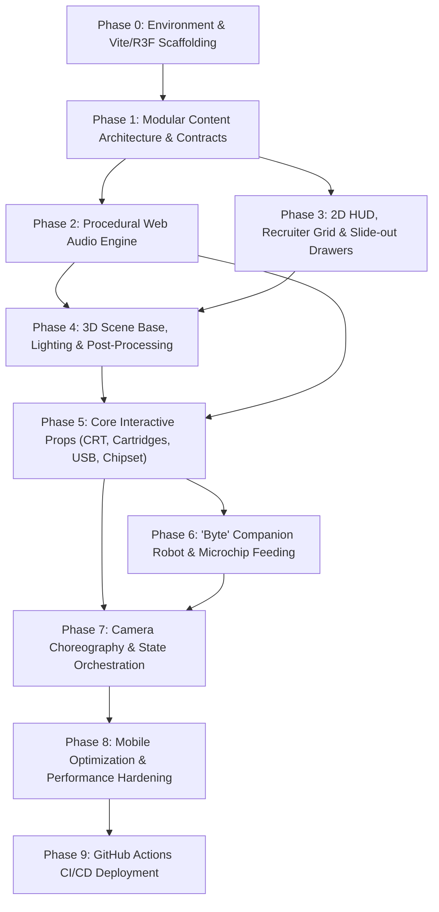

# Cyberpunk Unity Portfolio: Step-by-Step Execution Plan

**Project:** Interactive 3D Cyberpunk Portfolio  
**Target:** GitHub Pages (`c:\Alirezaftgithubpages`)  
**Architecture:** React + Vite + TypeScript + React Three Fiber + Tailwind CSS + Web Audio API  

---

## 1. Development Sequence & Phase Order

Building an interactive 3D web experience requires a strict **"Outside-In, Data-First"** assembly sequence. Creating 3D models before having data contracts or UI overlays leads to major rework. 

Here is the 9-phase dependency chain:



---

## 2. Phase-by-Phase Execution Breakdown

### Phase 0: Environment Setup & Scaffolding
* **Objective:** Establish the build foundation, verify GitHub Pages paths, and setup dependencies.
* **Tasks:**
  1. Initialize Vite React TypeScript project in `c:\Alirezaftgithubpages`.
  2. Install core packages:
     * `three`, `@types/three`
     * `@react-three/fiber`, `@react-three/drei`, `@react-three/postprocessing`
     * `tailwindcss`, `postcss`, `autoprefixer`
     * `lucide-react`, `clsx`, `tailwind-merge`, `canvas-confetti`
  3. Configure `vite.config.ts` with `base: './'` for proper static asset routing on GitHub Pages.
  4. Test empty R3F `<Canvas>` with DPR clamping (`[1, 1.5]`) and resize listener.

---

### Phase 1: Modular Content Architecture & Data Contracts
* **Objective:** Establish the modular file structure so content is decoupled from 3D presentation.
* **Tasks:**
  1. Create directory structure:
     * `src/content/projects/`
     * `src/content/skills/`
     * `src/content/profile/`
     * `src/content/companion/`
  2. Define TypeScript interfaces:
     * `Project`: ID, title, tagline, engine, tags, videoUrl, screenshots, techDeepDive (architecture, shaders, optimization), links (Steam, Itch, GitHub, webglDemoUrl).
     * `SkillChip`: ID, socketType (`cpu` | `gpu` | `ram` | `expansion`), label, category, proficiency, authenticMetrics, crossLinkedProjectIds.
     * `ProfileConfig`: Name, title, bio, careerTimeline, socials, resumePath.
     * `RobotLore`: Quotes, devTips, reactionLines, trivia.
  3. Populate 3 high-polish curated Unity projects (e.g., *Cyberpunk Action Platformer*, *Procedural Roguelike Dungeon*, *Compute Shader Fluid Simulation*).

---

### Phase 2: Procedural Web Audio Engine (Tactile SFX)
* **Objective:** Build the audio engine early so all subsequent interactions have instant tactile feedback.
* **Why Early?** Synthesizing audio via the native **Web Audio API** requires **0KB** of audio downloads and gives immediate kinetic impact.
* **Tasks:**
  1. Implement `src/audio/soundManager.ts`:
     * `playClick()`: Crisp high-frequency cyber tick (triangle/sine envelope, 15ms).
     * `playCrtPower()`: Low hum rising into high pitch phosphor buzz (sawtooth + bandpass filter).
     * `playBusPulse()`: Electrical data blip.
     * `playUsbPlug()`: Heavy mechanical snap + power-surge frequency sweep.
     * `playRobotChirp()`: Double harmonic sine frequency blips (cute Wall-E / R2 style).
     * `playRobotPurr()`: Low frequency vibrato purr when petted.
  2. Implement global audio state hook `useAudio` with opt-in mute toggle, volume control, and `localStorage` persistence.

---

### Phase 3: 2D HUD, Recruiter Grid & Slide-out Drawers
* **Objective:** Build the complete 2D UI layer so the portfolio is 100% functional even before 3D props are fully assembled.
* **Tasks:**
  1. **Top HUD (`src/components/ui/Hud.tsx`):**
     * Title logo / Status beacon (`ONLINE // DEV_STATION`).
     * Sound Toggle button with animated equalizer bars.
     * Mode Switcher: `[3D CYBER-DECK]` ⟷ `[RECRUITER GRID VIEW]`.
  2. **Recruiter Grid View (`src/components/ui/RecruiterGrid.tsx`):**
     * Fast, searchable, filterable grid of all projects, technical skill chips, bio timeline, and direct 1-click resume download.
  3. **Project Drawer (`src/components/ui/ProjectDrawer.tsx`):**
     * Slide-out glassmorphic panel on the right.
     * Video player, screenshot gallery, C# architecture breakdown, shader notes, and links.
  4. **Skill Telemetry Modal (`src/components/ui/SkillModal.tsx`):**
     * Floating AR schematic showing real engineering metrics and project cross-links.

---

### Phase 4: Seated 1st-Person Cyber-Deck Experience [IN PROGRESS]
* **Objective:** Deliver an authentic, immersive, high-signal 3D cyber-deck workspace featuring tactile physics, real-time CRT rendering, PCB diagnostics, and an interactive pet companion robot.
* **Architecture & Mechanics:**
  1. **Seated 1st-Person Camera & Pointer Lock Controller:**
     - Pointer Lock API (document.requestPointerLock()) with center reticle crosshair dot.
     - Clamped pitch ($-40^\circ \dots +50^\circ$) and yaw ($-75^\circ \dots +75^\circ$) keeping player anchored at developer chair.
     - Right-Click inspection zoom smoothly interpolating camera FOV (^\circ \rightarrow 22^\circ$) with forward nudge.
     - Mobile touch-drag camera look and on-screen zoom toggle fallback.
  2. **Cyber-Deck Station & Atmospheric Lighting Rig:**
     - Matte carbon desk surface, cable bundles, cyber-deck casing with drive bays and physical eject button.
     - Selective bloom on neon emissives, cyan key, magenta rim, and warm amber accent lights.
  3. **Hybrid 3D Asset Pipeline (Blender 5.2):**
     - Procedural Three.js geometry for desk architecture, frames, and substrate.
     - Dedicated hero props generated in Blender 5.2 to public/assets/models/:
       * cartridge.glb: Molded shell, grip ridges, gold pins, dynamic artwork face.
       * yte.glb: Pet robot with articulated head tracking and emoticon screen face.
       * probe.glb: Knurled multimeter logic probe with needle tip and cable.
       * usb.glb: Encrypted cyber USB drive with metal plug and activity LED.
  4. **Interactive CRT Monitor (<Html transform>):**
     - Default Boot Terminal CLI (CYBER-DECK KERNEL v4.2 // AWAITING MEDIA).
     - Native mouse wheel scrolling over monitor surface.
     - Zero-drift project tech spec rendering matching Recruiter Quick View.
  5. **Tactile Cartridge Drive & USB Resume Decryption:**
     - Left-click hold smooth lerp float pickup.
     - Magnetic snapping into computer drive bay with mechanical latch SFX.
     - Eject button pops cartridge back to desk.
     - USB drive insertion triggers power-surge SFX, decryption terminal animation, and authentic PDF CV download.
  6. **PCB Test Bench & Multimeter Logic Probe:**
     - Motherboard with CPU, GPU, RAM, and expansion ICs.
     - Probing pins triggers spark SFX, pulses copper bus traces, and shows dual telemetry on benchtop meter LCD + CRT monitor.
  7. **Byte Companion Pet Robot:**
     - Swivel head tracking player reticle.
     - Dynamic pixel emoticon face canvas (( ^ _ ^ ), ( > ᗢ < ), ( ♡ _ ♡ )).
     - Microchip snack tray for feeding + petting interactions + contextual developer lore bubbles.

---

### Phase 8: Mobile Optimization & Performance Hardening
* **Objective:** Ensure buttery 60fps across mobile phones, tablets, and low-power laptops.
* **Tasks:**
  1. **Touch Controls:** Enable smooth single-touch rotation/orbit and pinch-to-zoom limits.
  2. **Mobile Detection & Throttling:**
     * On mobile screens (< 768px), auto-adjust camera FOV for vertical portrait framing.
     * Lower DPR to `[1, 1.25]`.
     * Disable heavy bloom and expensive shadows if frame rate dips below 50fps.
  3. **Asset Lazy Loading:** Video textures only load on demand when a cartridge is engaged.

---

### Phase 9: GitHub Actions CI/CD Deployment
* **Objective:** Automate production builds and verify live GitHub Pages URL.
* **Tasks:**
  1. Create `.github/workflows/deploy.yml`.
  2. Configure permissions for `pages: write` and `id-token: write`.
  3. Verify `base: './'` build outputs cleanly to `dist/`.
  4. Test live site on desktop and mobile browsers.

---

## 3. Asset Creation & Sourcing Schedule

| Asset Category | Production Method | When to Create | File Output & Destination |
| :--- | :--- | :--- | :--- |
| **Data Contracts & Types** | Written directly in TypeScript | **Phase 1** | `src/content/*/types.ts` |
| **Sample Project Data** | Curated realistic Unity dev breakdowns | **Phase 1** | `src/content/projects/*.ts` |
| **Sound Synthesis Engine** | Procedural Web Audio API code (0KB) | **Phase 2** | `src/audio/soundManager.ts` |
| **UI Icons & Badges** | Lucide React + custom SVG cyberpunk decals | **Phase 3** | Inline React components |
| **3D Desk & Props** | High-performance Three.js procedural geometry & stylized shaders | **Phase 4 & 5** | `src/components/3d/*.tsx` |
| **Project Gameplay Clips** | Compact looping H.264/WebM videos (< 1.5MB each) | **Phase 5** | `public/assets/videos/*.webm` |
| **Screen Shaders / Masks** | Custom GLSL CRT scanline & curvature canvas shader | **Phase 5** | `src/components/3d/shaders/` |
| **Robot Eye Expressions** | Dynamic procedural 2D canvas texture | **Phase 6** | `src/components/3d/RobotFaceCanvas.ts` |
| **Resume PDF** | Clean sample developer CV | **Phase 5** | `public/assets/resume.pdf` |

---

## 4. Component Assembly Architecture

```
App.tsx
├── Hud (Fixed 2D Overlay: Mute toggle, Recruiter mode switch, status)
├── ProjectDrawer (Slide-out 2D panel when a cartridge is inserted)
├── SkillModal (Holographic AR overlay when a chipset is inspected)
├── RecruiterGrid (Full-screen 2D fast-scan view when toggled)
└── Scene (React Three Fiber Canvas)
    ├── CameraControls (Drei camera manager with state-driven lerping)
    ├── Lighting (Cyberpunk Cyan, Magenta, Amber lights)
    ├── PostProcessing (Selective Bloom, Vignette, Scanlines)
    └── DeskEnvironment
        ├── DeskSurface & CableBundles
        ├── CrtMonitor (Displays VideoTexture on screen mesh)
        ├── CartridgeRack (Holds ProjectCartridges)
        ├── ChipsetRack (Holds CPU, GPU, RAM, Expansion chips + traces)
        ├── UsbResumeChip (Plug-in trigger for CV download)
        ├── Datapad (Bio hologram anchor)
        ├── CommsTerminal (Contact anchor)
        └── CyberRobot ("Byte", eye canvas, microchip tray)
```
