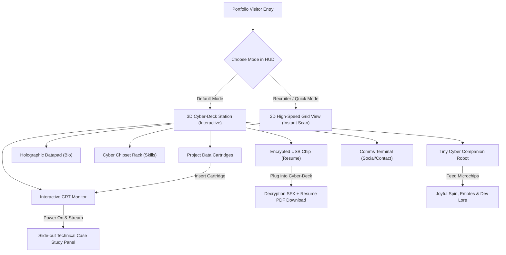

# Cyberpunk Interactive Portfolio: Technical & Product Specification

**Client:** Unity Game Developer  
**Lead Designer & Web Architect:** Senior Interactive Web Specialist  
**Hosting Target:** GitHub Pages (`https://<username>.github.io`)  
**Deployment Path:** `c:\Alirezaftgithubpages`  

---

## 1. Executive Summary & Design Vision

The objective is to create a high-impact, interactive 3D web portfolio that immediately demonstrates the client's caliber as a Unity game developer. The website adopts a **Cyberpunk / Neon Game Lab** aesthetic, centering around an interactive 3D developer desk (or "cyber-deck station") where visitors can tangibly interact with physical game developer props.

Crucially, the website solves the traditional "3D portfolio pitfall" (slow loading, friction for busy recruiters) by implementing a **Hybrid Dual-Mode UX**:
1. **The 3D Cyber-Deck:** An immersive, tactile 3D experience with physical props, real-time CRT monitor playback, interactive sound design, and an adorable companion robot you can feed.
2. **The Recruiter Quick-View:** A persistent, high-tech HUD allowing hiring managers to switch into a fast, searchable 2D grid/list of projects, skills, and resume with zero friction.



---

## 2. Technical Stack & Performance Architecture

### 2.1 Core Stack
* **Framework:** React 18 / 19 + TypeScript
* **Build Tool:** Vite (configured with relative base paths for seamless GitHub Pages hosting)
* **3D Engine:** Three.js + React Three Fiber (`@react-three/fiber`)
* **3D Helper Library:** `@react-three/drei` (cameras, HTML overlays, textures, loaders, shaders)
* **Post-Processing:** `@react-three/postprocessing` (selective bloom on neon emissives, chromatic aberration, vignette)
* **Styling & UI:** Tailwind CSS + Lucide Icons + Framer Motion (for buttery 2D slide-out panels and HUD animations)
* **Audio Synthesis:** Web Audio API (procedural sci-fi UI clicks, CRT static hum, USB power-surge, robot chimes—requiring zero heavy audio asset downloads)

### 2.2 Performance & Device Optimization Strategy
* **Asset Weight:** Low-poly procedural geometry and optimized GLTF assets (< 3MB total initial bundle).
* **Dynamic Pixel Ratio:** Clamped to `dpr={[1, 1.5]}` to prevent GPU thermal throttling on 3x/4x mobile retina screens.
* **Intelligent Frameloop:** Uses on-demand rendering (`frameloop="demand"` or frame throttling) when the scene is static, resuming 60fps only during animations and interactions.
* **Canvas Fallback:** Automatic low-power mode for low-end mobile devices (disables post-processing bloom while keeping full interactive functionality).

---

## 3. Interactive Props & Feature Specifications

### 3.1 Interactive CRT / OLED Game Monitor
* **Visual:** Retro-futuristic cyberpunk curved CRT monitor with subtle scanlines and phosphor glow.
* **Interaction:** Clicking any project cartridge automatically animates the cartridge into the deck reader, turns on the CRT monitor with a power-on flicker, and renders the project's gameplay video/canvas texture directly on the screen surface.
* **Complementary UI:** An elegant slide-out cyberpunk panel opens on the right side of the screen featuring:
  * Project Title, Genre, Platform, Engine (Unity version, render pipeline).
  * Video Reel & Screenshots carousel.
  * Technical Deep-Dive: Architecture breakdown, C# design patterns, shader graphs, and optimization achievements.
  * Direct Action Buttons: "Play WebGL Build" (opens responsive modal), "Steam / Itch.io", and "GitHub Repo".

### 3.2 The Cartridge Rack (Projects)
* A row of labeled, glowing cyber cartridges positioned next to the cyber-deck.
* Hovering displays a holographic hover tag with the game's title and key art.
* Clicking focuses the camera and slots the cartridge into the drive.

### 3.3 Holographic Datapad (About & Experience)
* An illuminated tablet resting on the desk.
* Clicking zooms the camera into a holographic projection showing:
  * Game Developer Bio and professional philosophy.
  * Shipped titles & studio experience timeline.
  * High-level game development roles (Gameplay Programming, Systems Architecture, Graphics/Shaders).

### 3.4 Cyber Chipset Rack (Technical Skills & Diagnostics)

#### Visual Appearance & Aesthetic
* **Form Factor:** An exposed, angled diagnostic test bench / motherboard rack mounted on the desk, styled like a futuristic hardware engineering station.
* **Materials:** Matte-black PCB substrate with intricate gold and glowing cyan copper bus traces running between sockets.
* **Component Architecture:**
  * **Core Processor (CPU Socket):** An oversized central chip with a laser-etched, glowing Unity emblem and anodized heatsink fins, representing **Unity Engine & C# Architecture**.
  * **Graphics Coprocessor (GPU Module):** Pink/magenta accented chip with miniature copper heat-pipes, dedicated to **Shaders, HLSL, URP/HDRP, and VFX Graph**.
  * **High-Speed RAM Modules:** Vertical DIMM-style riser sticks with blinking surface-mount activity LEDs, representing **DOTS/ECS, Memory Management, and Addressables**.
  * **Expansion ICs & Bridge Chips:** Smaller surface-mount integrated circuits representing **Physics, NavMesh AI, Multiplayer/Networking, Git CI/CD, and Blender**.
* **Status Readout:** An onboard segment display reading `CORE STATUS: NOMINAL // OVERCLOCK READY`.

#### Interaction Mechanics
* **Cursor Proximity & Hover (Bus Trace Lighting):**
  * Hovering over any chip illuminates the electrical bus traces connecting that chip to the main system, showing a pulse of data packets travelling along the PCB.
  * A light magnetic audio click and faint electrical hum triggers.
  * The chip elevates slightly (`z-lift`) with an emissive glow boost and a mini floating pinout badge (e.g., `[IC-01: UNITY / C#] // STATUS: SPECIALIST`).
* **Click to Inspect (Macro Camera Zoom):**
  * Clicking any chip smoothly pivots the camera into a close-up macro diagnostic view of that socket.
  * The clicked chip pulses with an overclocking rhythm, and the diagnostic display locks onto that chip’s telemetry.

#### Communication & User Feedback
* **Holographic Diagnostic Schematic (AR Telemetry Panel):**
  * When a chip is engaged, a crisp holographic telemetry readout materializes beside the rack featuring:
    1. **Module Name & Experience:** e.g., `CORE PROCESSOR // C# & UNITY ENGINE (6+ Years Shipped)`.
    2. **Authentic Game-Dev Engineering Metrics:** Replaces arbitrary percentages with concrete engineering capabilities:
       * *Architecture:* State Machines, Event-Driven Systems, Component-Based Decoupling, Object Pooling.
       * *Graphics & Shaders:* HLSL custom lighting, Shader Graph, Post-Processing stacks, Stencil/Dissolve shaders.
       * *Optimization:* Frame Profiler analysis, Draw Call & SetPass reduction, Garbage Collection zero-allocation patterns.
    3. **"In Action" Project Cross-Links:** Every skill chip highlights which of your shipped game cartridges on the desk utilize that technology (e.g., *"Demonstrated in Project Cyber-Odyssey via custom post-processing & compute shaders"*). Clicking the cross-link automatically slots the corresponding cartridge into the CRT monitor!
* **The "Overclock Diagnostic" Switch (Tactile Easter Egg):**
  * A miniature toggle switch labeled `[OVERCLOCK TEST]` on the board. Flipping it causes all bus traces to surge with high-energy amber/red pulses, fans spin with a revving sound, and Byte the robot perks up and tracks the board with wide, excited eyes!

### 3.5 Encrypted USB Chip (Interactive Resume Download)
* A high-tech physical USB cyber-key resting on the desk beside an open USB/expansion port.
* **Interaction:** The user clicks the USB chip. It floats, aligns, and slides directly into the port with a glowing power surge animation and a sci-fi mechanical audio cue.
* **Action:** Immediately triggers the resume decryption readout and downloads the client's Resume / CV PDF file.

### 3.6 Comms Terminal (Contact & Social Links)
* A retro-futuristic radio transceiver / terminal with an interactive status light.
* Provides:
  * Direct copy-to-clipboard email address.
  * Links to LinkedIn, GitHub, Itch.io, ArtStation / YouTube, and Discord.
  * Quick message / contact form.

### 3.7 The Desk Companion: "Byte" the Cyber Robot (Mini-Game & Easter Egg)
* **Character:** A compact, charming low-poly desktop robot with an expressive digital screen face (eyes that blink, squint with joy, or look curious).
* **Interactions:**
  * **Petting / Clicking:** Clicking the robot makes it give an inquisitive chirp, tilt its head, or perform a happy hop.
  * **Microchip Feeding:** A small tray of glowing microchips sits beside the robot. Visitors can click or drag a microchip to Byte.
  * **Reaction:** Byte munches the microchip, displays heart/star screen eyes, does a 360-degree victory spin, and emits a playful speech bubble with random game-dev easter eggs, quirky dev tips, or secret commentary about the client's games!

---

## 4. Modular Content Architecture

To ensure content management is effortless and maintainable over time, the project adheres to a strictly modular directory structure. Content is never bundled into one monolithic file.

```
src/
├── content/
│   ├── config.ts                    # Global developer metadata (Name, Title, Socials, Resume URL)
│   ├── profile/
│   │   ├── bio.ts                   # About me, game dev background, philosophy
│   │   └── experience.ts            # Career timeline, shipped studios & titles
│   ├── projects/
│   │   ├── types.ts                 # TypeScript interfaces for Project schemas
│   │   ├── project-01-cyber-game.ts # Individual project modular definition
│   │   ├── project-02-roguelike.ts  # Individual project modular definition
│   │   ├── project-03-shader-lab.ts # Individual project modular definition
│   │   └── index.ts                 # Clean barrel export of all projects
│   ├── skills/
│   │   ├── types.ts                 # TypeScript interfaces for Skill categories
│   │   ├── engines-languages.ts     # Unity, C#, HLSL, etc.
│   │   ├── gameplay-systems.ts      # AI, Physics, UI, Multiplayer
│   │   ├── tools-optimization.ts    # Profiling, Git, Blender
│   │   └── index.ts                 # Clean barrel export of all skill chips
│   └── companion/
│       └── quotes.ts                # Dialogue lines, easter eggs, and trivia for Byte the Robot
├── public/
│   ├── assets/
│   │   ├── models/                  # 3D models (GLTF/GLB)
│   │   ├── textures/                # Texture maps & CRT masks
│   │   ├── videos/                  # Optimized H.264/WebM project gameplay reels
│   │   ├── icons/                   # Custom UI icons
│   │   └── resume.pdf               # Downloadable CV
```

### Adding a New Project in the Future:
To add a new game in the future, the developer only needs to:
1. Create `src/content/projects/my-new-game.ts` conforming to `Project` interface.
2. Add one line to `src/content/projects/index.ts`.
3. The 3D cartridge rack, CRT monitor, and Recruiter Grid View automatically reflect the new project!

---

## 5. Deployment & CI/CD Pipeline

* **Repository:** `c:\Alirezaftgithubpages`
* **Target:** GitHub Pages
* **Automation:** `.github/workflows/deploy.yml` triggers on push to `main`, running:
  1. `npm ci`
  2. `npm run build` (with `base: './'` for proper static asset routing)
  3. Deploys `dist` directly to GitHub Pages via `actions/deploy-pages`.
